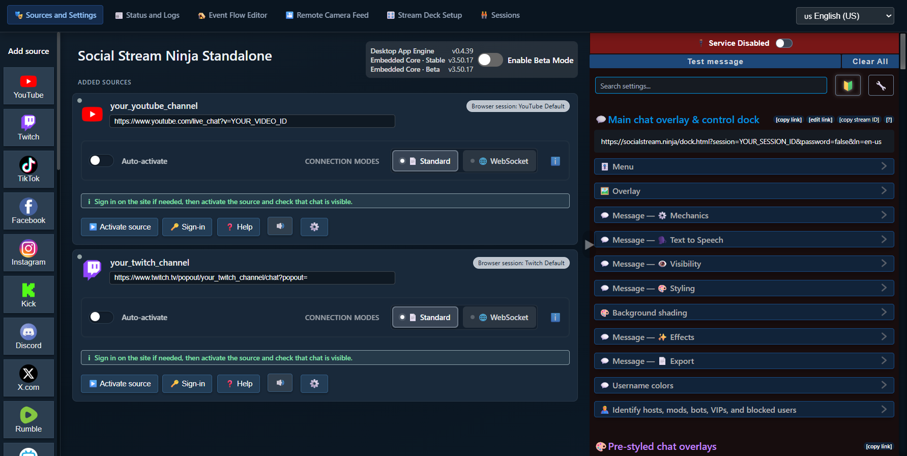

<p align="center">
  
</p>

<h1 align="center">Social Stream Ninja Desktop</h1>

<p align="center">Your live chats, overlays, and stream automation in one desktop app.</p>

<p align="center">
  <a href="https://github.com/steveseguin/social_stream/releases"><strong>Download</strong></a> ·
  <a href="docs/DESKTOP_APP.md">User guide</a> ·
  <a href="#ai-mcp-and-automation">AI &amp; MCP</a> ·
  <a href="https://socialstream.ninja/manual">Social Stream manual</a> ·
  <a href="https://discord.socialstream.ninja">Discord</a>
</p>

<p align="center">
  
  <a href="LICENSE"></a>
</p>

**SSApp** brings [Social Stream Ninja](https://socialstream.ninja) to your desktop. Collect chat from supported platforms, display it in OBS, and build stream interactions with overlays, text-to-speech, and Event Flow. Keep sources running in their own windows, manage separate sign-ins, and control the app yourself or through an optional AI client.



## Download and get started

Get the app from the **[Social Stream Ninja releases page](https://github.com/steveseguin/social_stream/releases)**. Desktop downloads are published there for all platforms.

| Platform | Downloads |
| --- | --- |
| Windows | Installer or portable executable |
| macOS | Intel or Apple Silicon build |
| Linux | AppImage; Arch users can also install `socialstreamninja` from the AUR |

1. Open **Sources and Settings** and choose a platform from the left sidebar.
2. Enter the channel, video ID, or chat URL requested by that source.
3. Choose an available connection mode, sign in if needed, and **activate the source**.
4. Use the right-side panel to copy your chat dock or overlay URL into OBS.

You can hide a source window while it keeps capturing. Stopping the source ends capture. The [desktop guide](docs/DESKTOP_APP.md) covers source setup, accounts, and everyday controls.

## Built for your stream

- **Multiple sources and accounts.** Combine supported platforms, choose Standard or direct-connection modes where available, and keep browser sessions separate for different accounts. Native Discord bot sources can capture and send channel messages without an open Discord Web window.
- **OBS docks and overlays.** Bring combined chat, highlighted messages, alerts, and other Social Stream outputs into your broadcast.
- **Event Flow and local media.** Turn chat and platform events into actions, with local audio, images, and video selected from your computer.
- **Voice and AI features.** Use local Kokoro or system text-to-speech, local speech recognition for the co-host workflow, and Social Stream's configurable AI providers.
- **Desktop window controls.** Hide sources, work from the system tray, and use always-on-top or click-through windows. Saved sources and settings survive restarts.
- **History and backups.** Browse and export saved messages, transfer settings, or use encrypted full-session archives to move browser sign-ins and downloaded models too.
- **Stream Deck and local connections.** Control sources from Stream Deck and connect local overlays through the optional WebSocket relay.
- **Headless operation.** Run capture on a home server or VPS with hidden windows. See [cloud and headless hosting](docs/CLOUD_HOSTING.md) for persistent profiles and Linux display setup.

## AI, MCP, and automation

SSApp includes a **Model Context Protocol (MCP) server** and a **local HTTP API**. Connect an MCP-capable AI client, such as Claude or Codex, or use the API from your own code. Your agent can work with structured source commands, inspect pages, or use screenshots and familiar browser input.

Automation is **opt-in**. Ordinary use requires no AI configuration; agent loops and live frame capture do not start automatically.

### What an agent can do

| Area | Available controls |
| --- | --- |
| Sources and settings | List, add, edit, remove, start, stop, and reload sources; apply filtered bulk actions; change mute, visibility, connection modes, and supported settings. |
| App and browser surfaces | Discover the main app, chat sources, sign-in windows, popups, embedded views, and DevTools with their target and parent relationships. |
| Screenshots and inspection | Capture real window images, read visible text and element references across frames, and request an on-demand local JPEG live view. |
| Mouse, keyboard, and touch | Click, double-click, right-click, hover, scroll, drag, select text, type Unicode, send shortcuts, hold keys or buttons, and use touch gestures. Screenshot coordinates can map directly to input. |
| Navigation and windows | Navigate, go back or forward, reload, stop loading, show, hide, focus, resize, minimize, maximize, restore, or close supported windows. Hidden sources remain controllable. |
| Menus, dialogs, and files | Read and invoke app/context menus, wait for prompts, accept or cancel dialogs, and select user-authorized host files for uploads or open/save dialogs. |
| Diagnostics and events | Inspect source health, process information, capture counters, and recent events; wait for new events and follow resumable status/operation updates. |
| Settings exports | Create a confirmed temporary backup, retrieve it in bounded chunks with a SHA-256 checksum, and release it when finished. Requires SSApp 0.4.39 or newer. |
| App lifecycle and handoff | Reload or shut down the app, show a window for human sign-in, and detect stale requests after an app restart. |

These controls operate **SSApp-owned surfaces**. Browser input does not move your desktop mouse. Let a person complete private sign-in steps, and authorize file selection or settings exports explicitly: backups can include saved credentials.

### Connect an AI client

1. Open **File > Local AI / Automation > Enable Local Control API** and restart SSApp.
2. Return to the same menu and select **Copy MCP Setup**.
3. Paste the configuration into your AI client's MCP settings and reconnect it.
4. Have the agent call `ssapp_get_capabilities` first, then read the app's status.

The downloaded app runs its own MCP adapter through `--ssapp-mcp`. No separate Node installation or source checkout is needed. Capabilities report the running app/API versions and supported commands so clients can adapt to the installed build.

Example requests for a connected agent:

- “List my sources and show which ones are running.”
- “Inspect the stalled source and show me its screenshot and recent capture events.”
- “Mute my Twitch sources and hide their windows.”
- “Export my settings and save a backup.”

For direct code integrations, the default API address is `http://127.0.0.1:17777`. It is tokenless and restricted to this computer. See the [automation reference](docs/AUTOMATION.md) for MCP tools, HTTP commands, events, browser controls, and export handling.

### Remote agents

**[Ninja MCP](https://github.com/steveseguin/ninjamcp)** can connect an agent on another computer to SSApp's tools. It provides separate agent credentials, observer/controller roles, one controller at a time, WebRTC transport, and optional HTTP fallback. Follow its [SSApp integration guide](https://steveseguin.github.io/ninjamcp/ssapp-integration.html); keep SSApp's own control API on loopback.

### Local and hosted models

For app control, the AI client or agent harness supplies the model and runs the tool loop. A custom harness can use a local or hosted LLM that supports its tool-calling workflow, including an OpenAI-compatible server such as vLLM. Configure that endpoint in the harness.

Social Stream also offers **AI features for your stream**: chat replies, a private assistant, translation, moderation, chat summaries, document-based answers for the Primary bot, AI overlay creation, and a voice co-host. Select a provider under **Chat Bots and AI services > Configure LLM Service Provider**, then enable the feature you want to use. Options include local models, Ollama, cloud providers, and a Custom API endpoint. See [AI modes](https://socialstream.ninja/docs/ai-modes-guide.html) and the [AI co-host guide](https://socialstream.ninja/docs/ai-cohost-guide.html).

## Guides and support

| Guide | What it covers |
| --- | --- |
| [Desktop app guide](docs/DESKTOP_APP.md) | Sources, sessions, local media, voice, history, backups, and troubleshooting |
| [Automation, MCP, and APIs](docs/AUTOMATION.md) | AI setup, browser input, tools, HTTP endpoints, and local services |
| [Native Discord sources](docs/DISCORD_NATIVE.md) | Bot setup, permissions, channel selection, and token storage |
| [Cloud and headless hosting](docs/CLOUD_HOSTING.md) | AppImage deployment, Xvfb, persistent profiles, and systemd |
| [Linux notes](docs/LINUX_NOTES.md) | Installation, portable data, tray support, voice, and display options |
| [All documentation](docs/README.md) | The full desktop documentation index |

For help, join [Discord](https://discord.socialstream.ninja). Report desktop bugs in the [SSApp issue tracker](https://github.com/steveseguin/ssn_app/issues).

## Run from source

Use Node.js 20.9 or newer and npm. Native dependencies may also need Python and your platform's build tools.

```bash
git clone https://github.com/steveseguin/ssn_app.git
cd ssn_app
npm install
npm run start2
```

This repository contains the desktop application. The shared chat sources, overlays, and web interface live in [social_stream](https://github.com/steveseguin/social_stream). To work on those, load a neighboring checkout with **File > Load Social Stream From Folder**. On Linux, `npm run start-linux` uses `../social_stream`.

Build with `npm run build:win32`, `npm run build:darwin`, or `npm run build:linux`. Read [contributing](CONTRIBUTING.md), [code signing](CODE_SIGNING.md), and the [release guide](RELEASE.md) before preparing a distribution.

---

Licensed under the [GNU General Public License v3.0](LICENSE).
